<div align="center">

# [中文](README.md) &nbsp;|&nbsp; English

</div>

# zhouxing-ppt-skill

ZhouXing PPT Skill · **v1.0.0** first public release.

Twelve confirmed offline HTML presentation themes for editable, downloadable Chinese and English decks.

## Highlights

- Twelve confirmed themes: SHIFT, FOCUS, EDIT, FORM, INDEX, AXIS, SKETCH, GLOW, ECHO, SPARK, BLEND, GROVE
- **24 replaceable SVG icons** per theme
- HTML decks support **inline text editing**, **HTML download**, and **PDF download**
- Custom mouse cursor designed per theme
- Bilingual templates, fonts, and license files included for offline use

## Quick start

Load this repository as a Cursor / Agent skill, then follow [SKILL.md](SKILL.md). Example:

```sh
python3 scripts/create_deck.py --style shift --lang en --out /absolute/path/to/new-deck
python3 scripts/build_deck.py --project /absolute/path/to/new-deck
```

Theme registry: [styles.json](styles.json). Details in `references/*.md`.

## Theme Gallery

Each theme shows 6 sample slides (two rows of three). Full decks live in each theme folder as `example-zh.html` / `example-en.html`.

### [SHIFT (流变)](assets/styles/shift/)

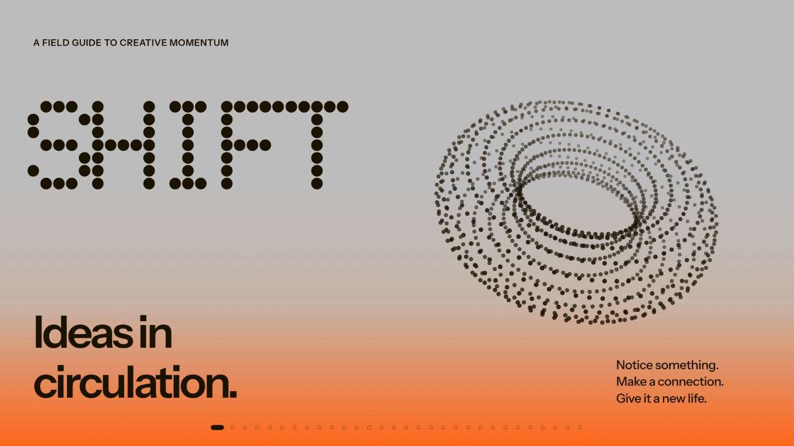 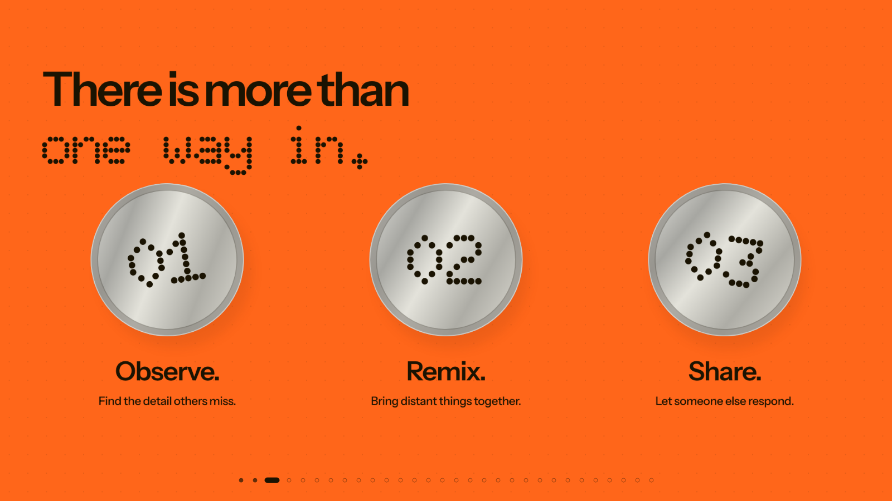 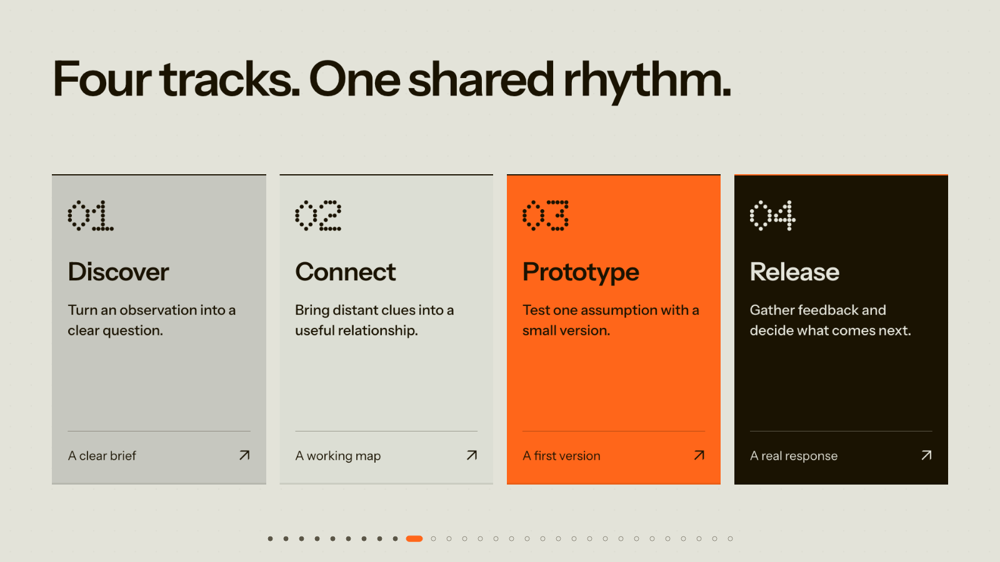

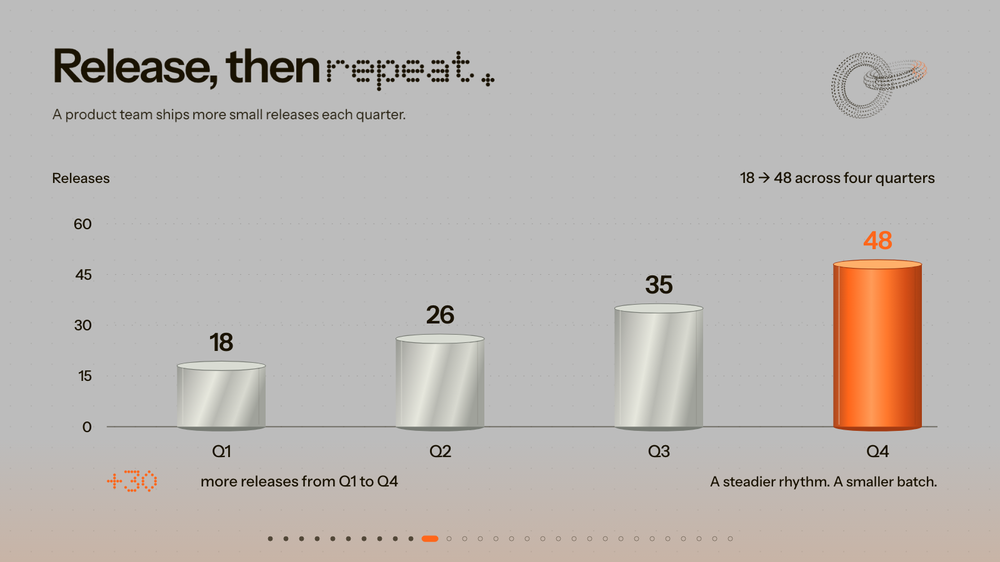 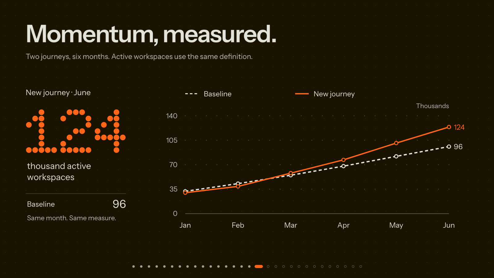 

### [FOCUS (明晰)](assets/styles/focus/)

  

  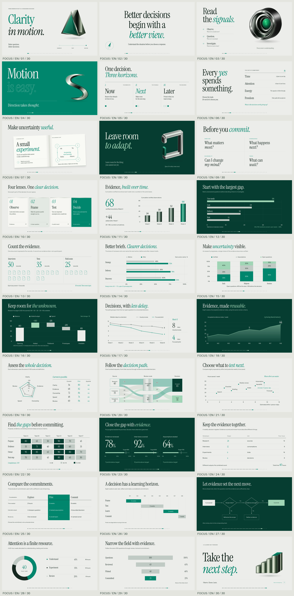

### [EDIT (精选)](assets/styles/edit/)

  

  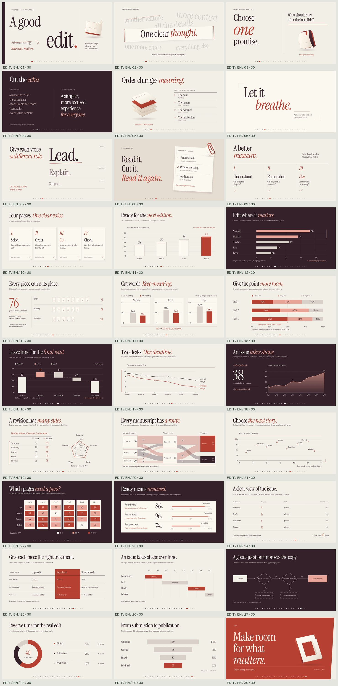

### [FORM (成形)](assets/styles/form/)

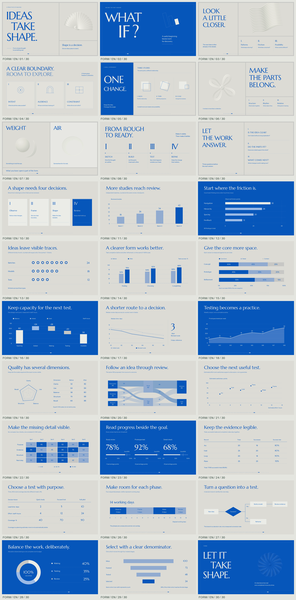  

  

### [INDEX (索引)](assets/styles/index/)

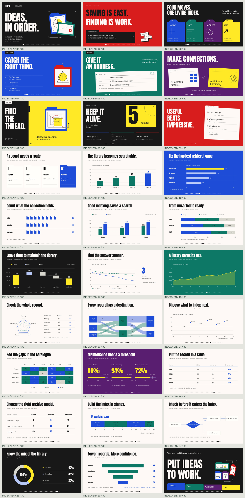  

  

### [AXIS (轴线)](assets/styles/axis/)

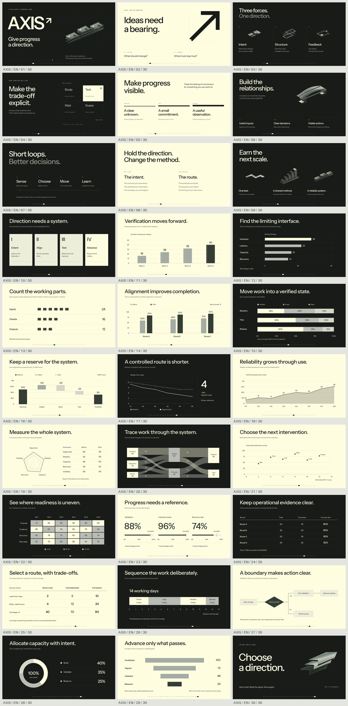  

  

### [SKETCH (构想)](assets/styles/sketch/)

  

 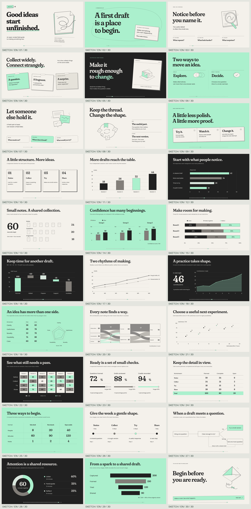 

### [GLOW (晴光)](assets/styles/glow/)

  

 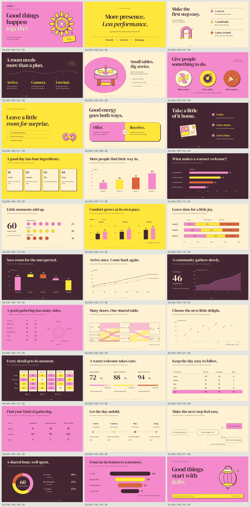 

### [ECHO (回响)](assets/styles/echo/)

  

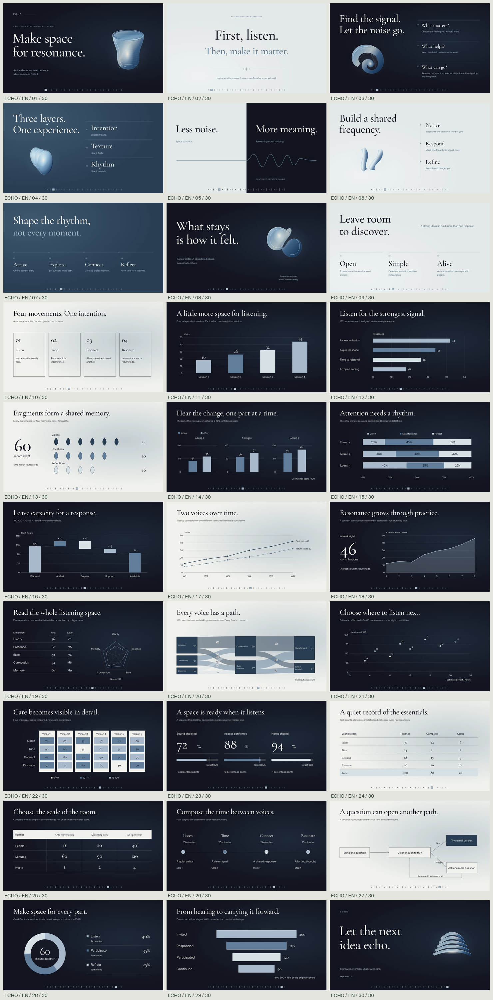  

### [SPARK (燃点)](assets/styles/spark/)

  

  

### [BLEND (融合)](assets/styles/blend/)

  

  

### [GROVE (共生)](assets/styles/grove/)

  

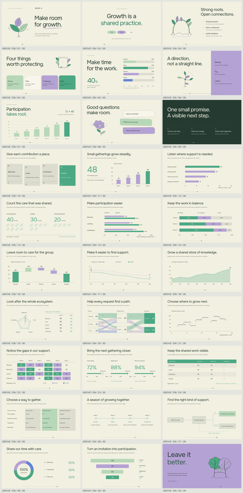  

## License

Per-theme font, SVG, and dependency licenses remain under each `assets/styles/<id>/` tree (`fonts/`, `graphics/`, `source/`). Follow those files for use and redistribution.
