<div align="center">

# 简体中文 &nbsp;|&nbsp; [English](README.en.md)

</div>

# zhouxing-ppt-skill

昼星 PPT Skill · **v1.1.0** · 新主题顺序与 LENS 透见。

用十二套已确认的离线 HTML 演示主题，快速做出可编辑、可下载的中英文 PPT。

## 功能亮点

- 十二套已确认主题：BLEND 融合、GROVE 共生、SPARK 燃点、ECHO 回响、GLOW 晴光、SKETCH 构想、AXIS 轴线、INDEX 索引、FORM 成形、LENS 透见、FOCUS 明晰、EDIT 精选
- 每套 PPT 内置 **24 个 SVG 图标**，支持替换图标
- HTML PPT **支持编辑文字**，支持下载 **HTML**，支持下载 **PDF**
- 每套 PPT 的鼠标都按对应主题单独设计
- 中英双语模板、字体与许可文件随包提供，可离线使用

## 快速使用

把本仓库作为 Cursor / Agent 的 Skill 目录加载后，按 [SKILL.md](SKILL.md) 操作。创建工作副本示例：

```sh
python3 scripts/create_deck.py --style blend --lang zh-CN --out /absolute/path/to/new-deck
python3 scripts/build_deck.py --project /absolute/path/to/new-deck
```

主题登记见 [styles.json](styles.json)。详细约定见各 `references/*.md`。

## 主题样张

每套展示 6 张样稿（两行，每行 3 张）。完整样片见各主题目录下的 `example-zh.html` / `example-en.html`。

### [01 · BLEND · 融合](assets/styles/blend/)

<a href="https://raw.githubusercontent.com/ZhouXing-AI/zhouxing-ppt-skill/main/assets/styles/blend/previews-zh/slide-01.png">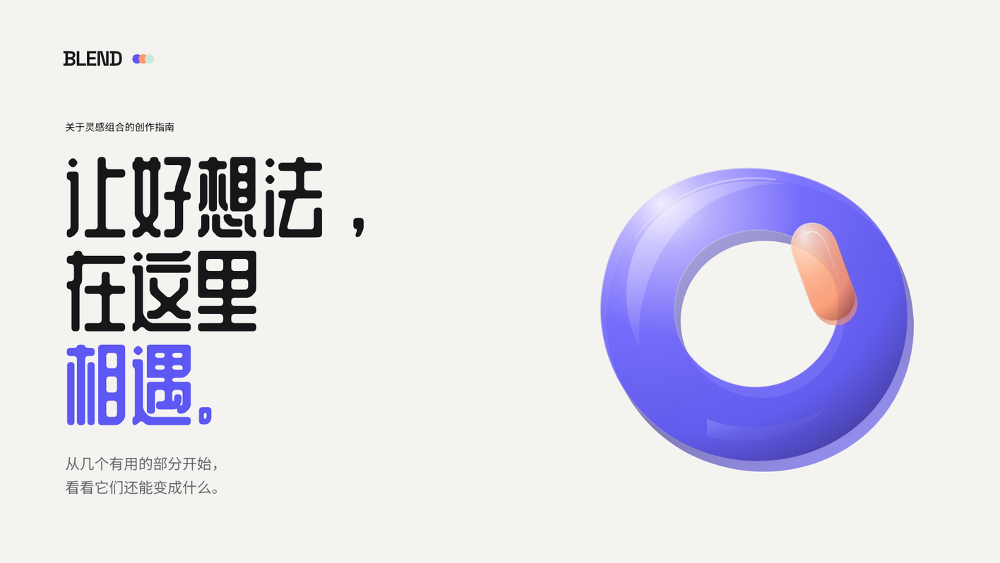</a> <a href="https://raw.githubusercontent.com/ZhouXing-AI/zhouxing-ppt-skill/main/assets/styles/blend/previews-zh/slide-07.png"></a> <a href="https://raw.githubusercontent.com/ZhouXing-AI/zhouxing-ppt-skill/main/assets/styles/blend/previews-zh/slide-03.png"></a>

<a href="https://raw.githubusercontent.com/ZhouXing-AI/zhouxing-ppt-skill/main/assets/styles/blend/previews-zh/slide-04.png"></a> <a href="https://raw.githubusercontent.com/ZhouXing-AI/zhouxing-ppt-skill/main/assets/styles/blend/previews-zh/slide-05.png">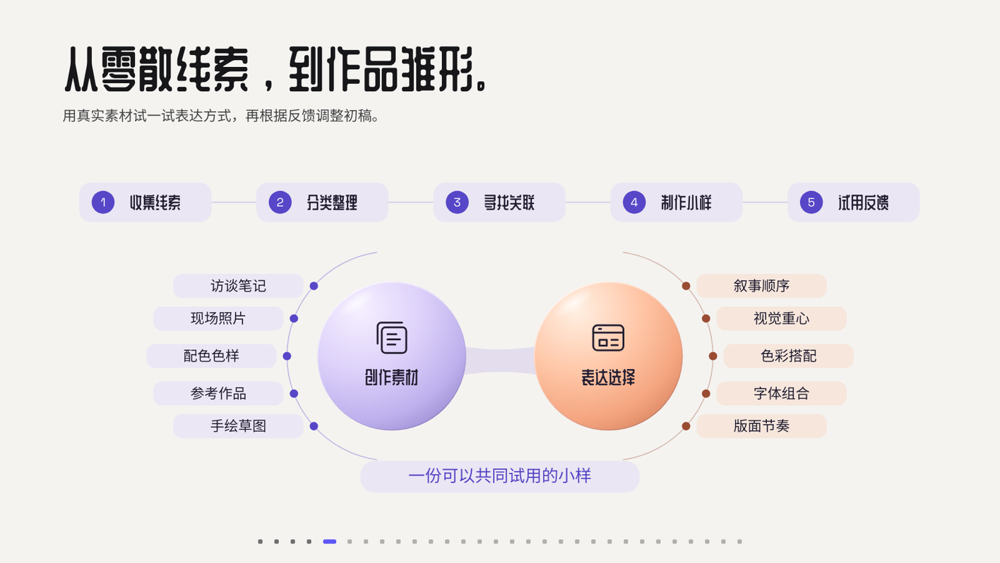</a> <a href="https://raw.githubusercontent.com/ZhouXing-AI/zhouxing-ppt-skill/main/assets/styles/blend/previews-zh/slide-09.png">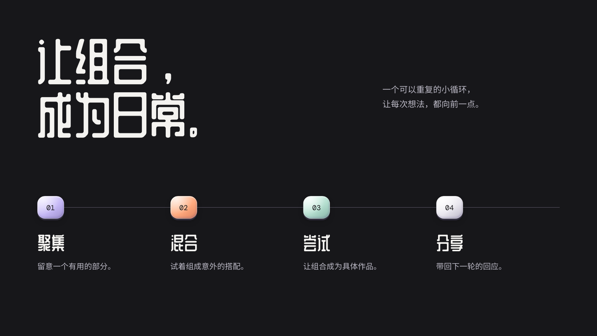</a>

### [02 · GROVE · 共生](assets/styles/grove/)

<a href="https://raw.githubusercontent.com/ZhouXing-AI/zhouxing-ppt-skill/main/assets/styles/grove/previews-zh/slide-01.png">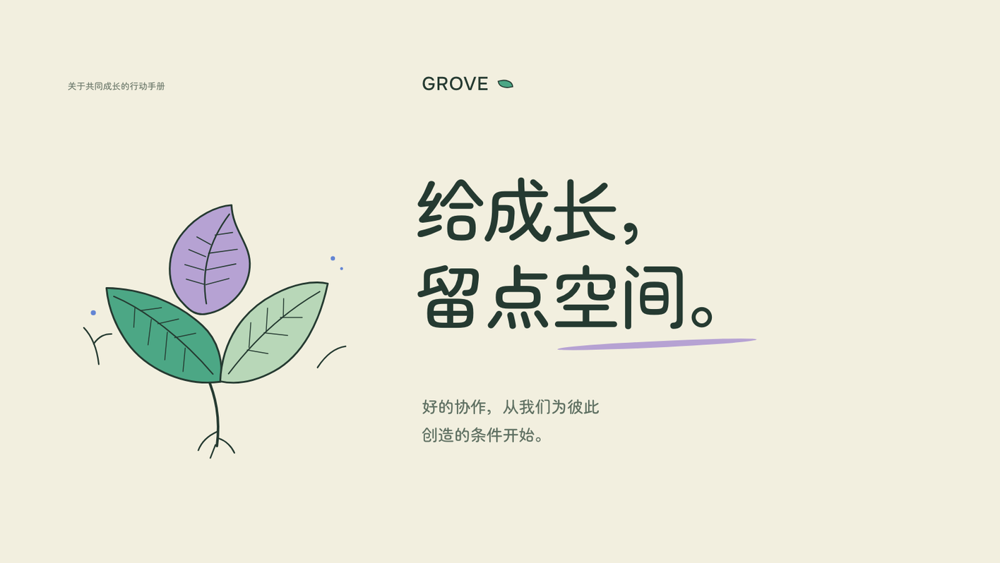</a> <a href="https://raw.githubusercontent.com/ZhouXing-AI/zhouxing-ppt-skill/main/assets/styles/grove/previews-zh/slide-04.png">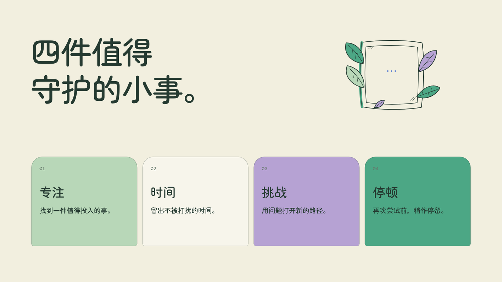</a> <a href="https://raw.githubusercontent.com/ZhouXing-AI/zhouxing-ppt-skill/main/assets/styles/grove/previews-zh/slide-05.png"></a>

<a href="https://raw.githubusercontent.com/ZhouXing-AI/zhouxing-ppt-skill/main/assets/styles/grove/gallery-zh/slide-13.webp">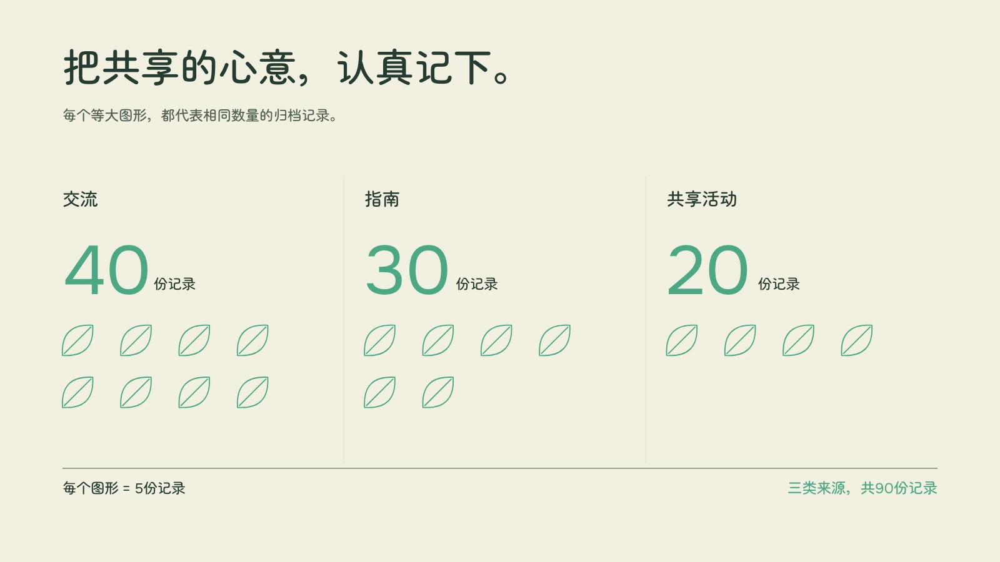</a> <a href="https://raw.githubusercontent.com/ZhouXing-AI/zhouxing-ppt-skill/main/assets/styles/grove/previews-zh/slide-08.png">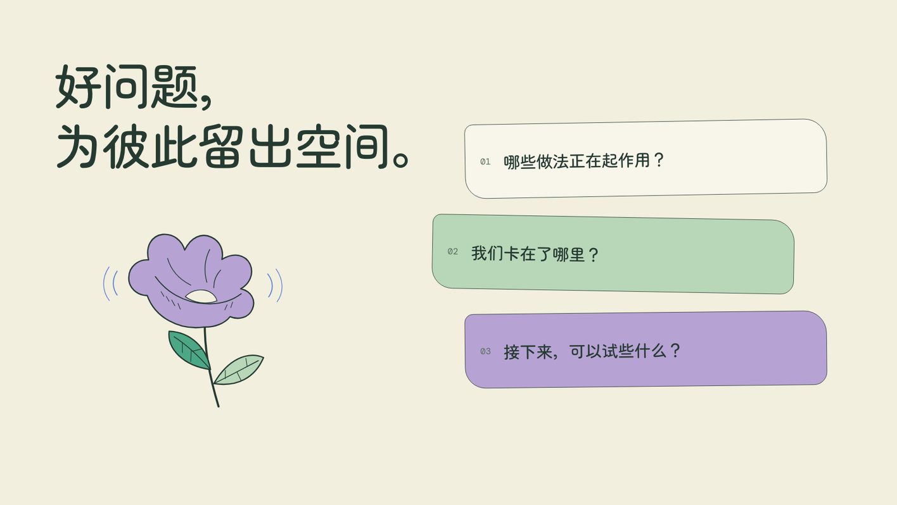</a> <a href="https://raw.githubusercontent.com/ZhouXing-AI/zhouxing-ppt-skill/main/assets/styles/grove/previews-zh/slide-09.png">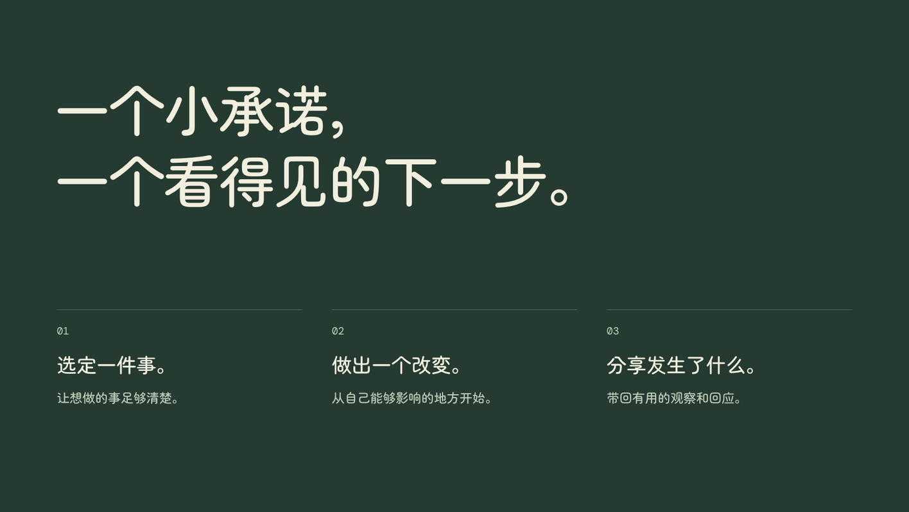</a>

### [03 · SPARK · 燃点](assets/styles/spark/)

<a href="https://raw.githubusercontent.com/ZhouXing-AI/zhouxing-ppt-skill/main/assets/styles/spark/previews-zh/slide-01.png"></a> <a href="https://raw.githubusercontent.com/ZhouXing-AI/zhouxing-ppt-skill/main/assets/styles/spark/previews-zh/slide-03.png">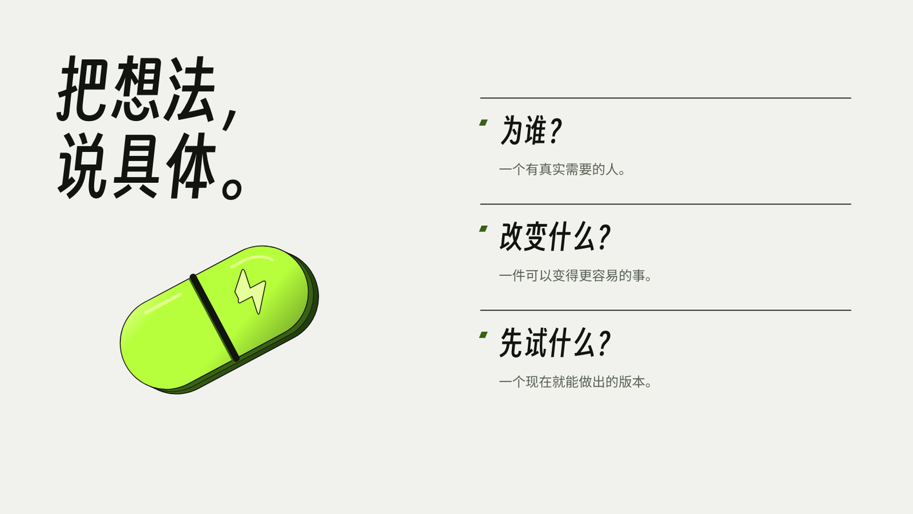</a> <a href="https://raw.githubusercontent.com/ZhouXing-AI/zhouxing-ppt-skill/main/assets/styles/spark/previews-zh/slide-04.png">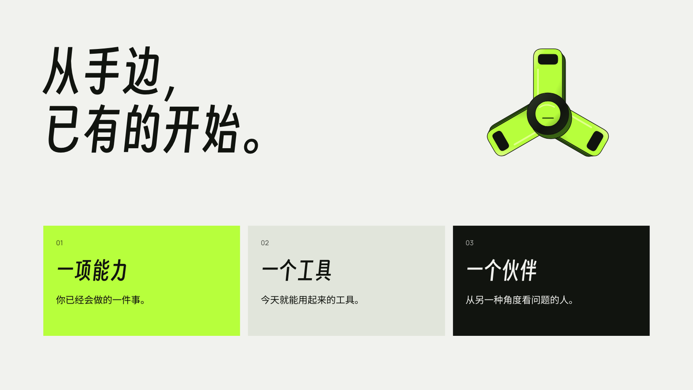</a>

<a href="https://raw.githubusercontent.com/ZhouXing-AI/zhouxing-ppt-skill/main/assets/styles/spark/previews-zh/slide-07.png">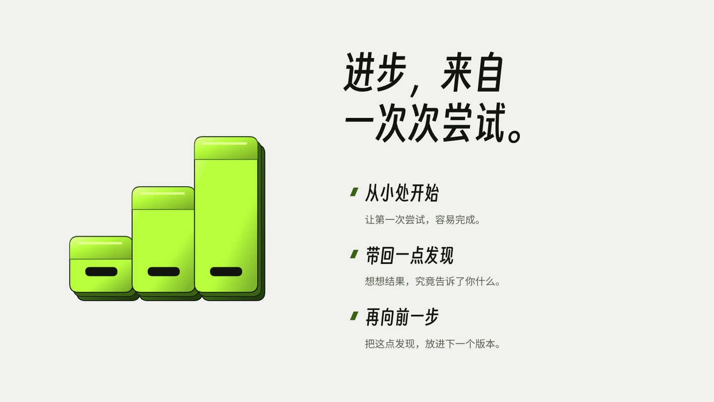</a> <a href="https://raw.githubusercontent.com/ZhouXing-AI/zhouxing-ppt-skill/main/assets/styles/spark/previews-zh/slide-08.png"></a> <a href="https://raw.githubusercontent.com/ZhouXing-AI/zhouxing-ppt-skill/main/assets/styles/spark/previews-zh/slide-09.png">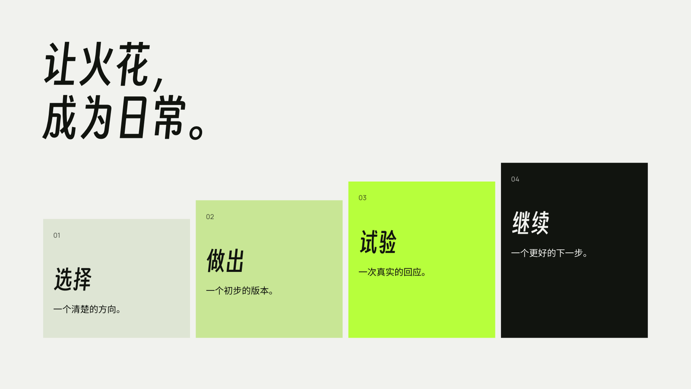</a>

### [04 · ECHO · 回响](assets/styles/echo/)

<a href="https://raw.githubusercontent.com/ZhouXing-AI/zhouxing-ppt-skill/main/assets/styles/echo/previews-zh/slide-01.png">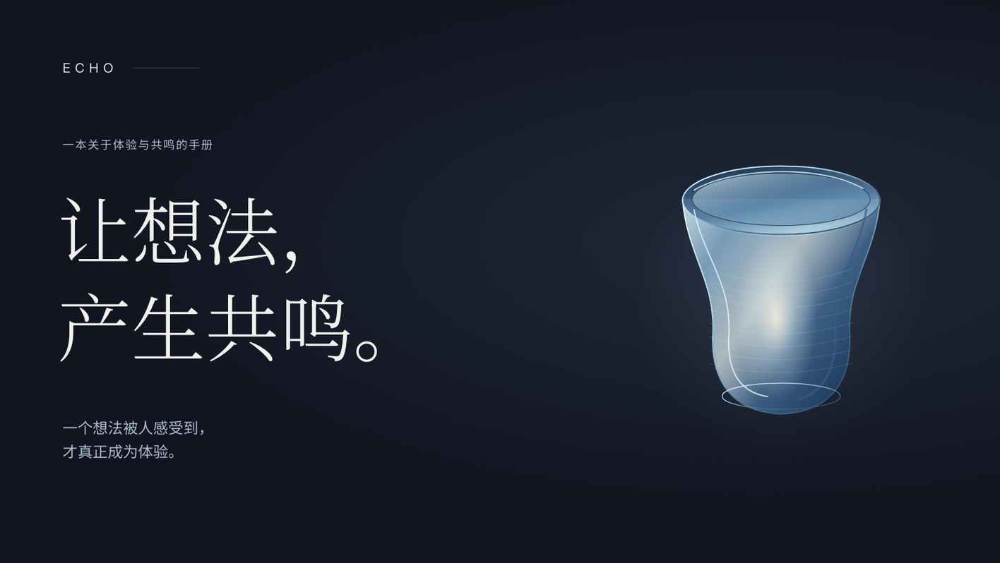</a> <a href="https://raw.githubusercontent.com/ZhouXing-AI/zhouxing-ppt-skill/main/assets/styles/echo/previews-zh/slide-05.png">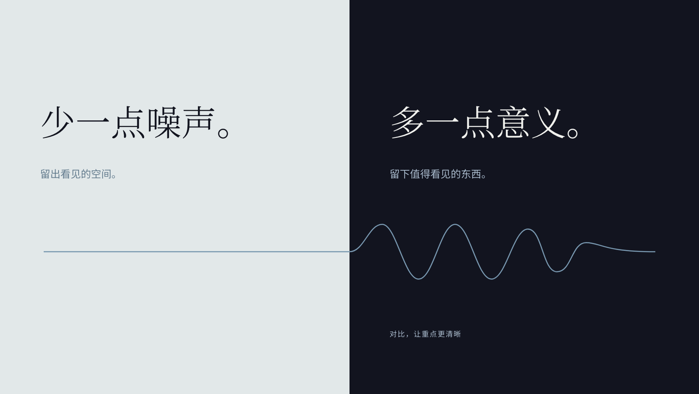</a> <a href="https://raw.githubusercontent.com/ZhouXing-AI/zhouxing-ppt-skill/main/assets/styles/echo/previews-zh/slide-04.png">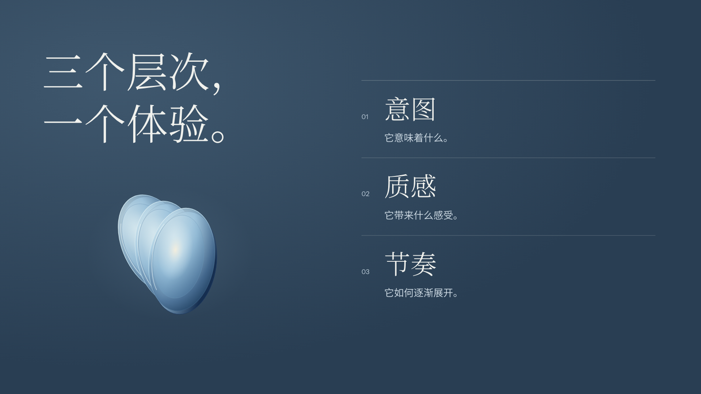</a>

<a href="https://raw.githubusercontent.com/ZhouXing-AI/zhouxing-ppt-skill/main/assets/styles/echo/gallery-zh/slide-13.webp"></a> <a href="https://raw.githubusercontent.com/ZhouXing-AI/zhouxing-ppt-skill/main/assets/styles/echo/gallery-zh/slide-20.webp"></a> <a href="https://raw.githubusercontent.com/ZhouXing-AI/zhouxing-ppt-skill/main/assets/styles/echo/gallery-zh/slide-30.webp"></a>

### [05 · GLOW · 晴光](assets/styles/glow/)

<a href="https://raw.githubusercontent.com/ZhouXing-AI/zhouxing-ppt-skill/main/assets/styles/glow/previews-zh/slide-01.png"></a> <a href="https://raw.githubusercontent.com/ZhouXing-AI/zhouxing-ppt-skill/main/assets/styles/glow/previews-zh/slide-02.png">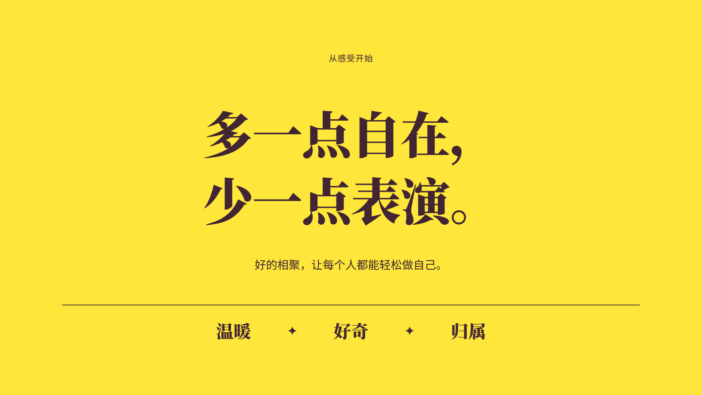</a> <a href="https://raw.githubusercontent.com/ZhouXing-AI/zhouxing-ppt-skill/main/assets/styles/glow/previews-zh/slide-03.png"></a>

<a href="https://raw.githubusercontent.com/ZhouXing-AI/zhouxing-ppt-skill/main/assets/styles/glow/previews-zh/slide-04.png">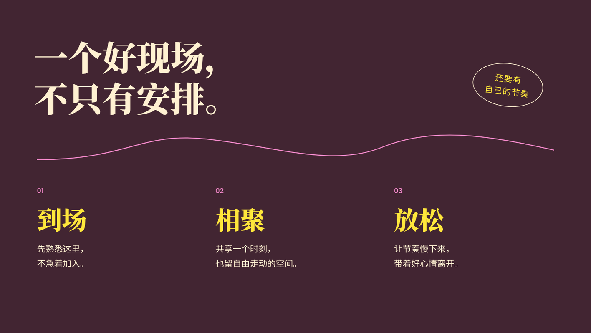</a> <a href="https://raw.githubusercontent.com/ZhouXing-AI/zhouxing-ppt-skill/main/assets/styles/glow/gallery-zh/slide-13.webp"></a> <a href="https://raw.githubusercontent.com/ZhouXing-AI/zhouxing-ppt-skill/main/assets/styles/glow/gallery-zh/slide-23.webp">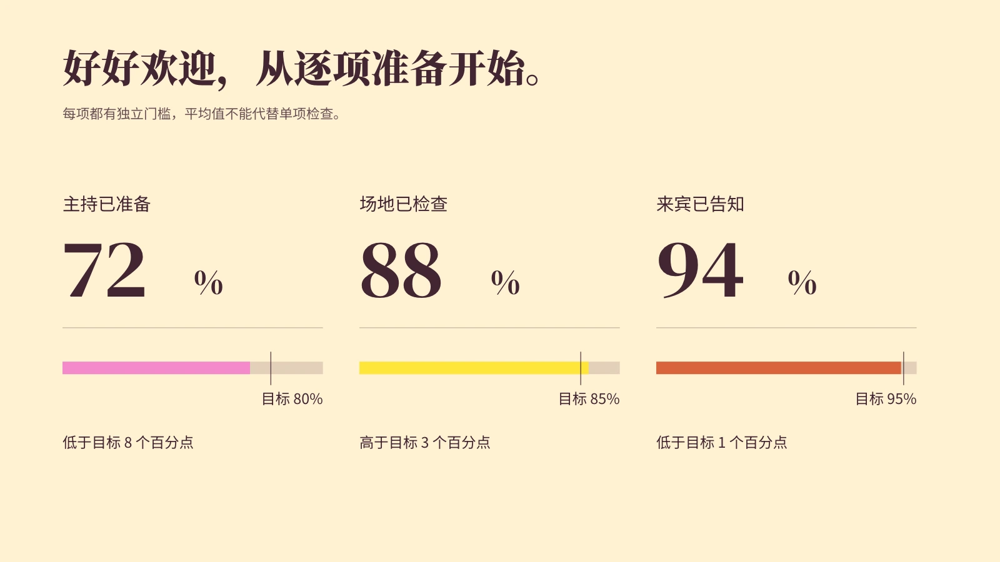</a>

### [06 · SKETCH · 构想](assets/styles/sketch/)

<a href="https://raw.githubusercontent.com/ZhouXing-AI/zhouxing-ppt-skill/main/assets/styles/sketch/previews-zh/slide-01.png">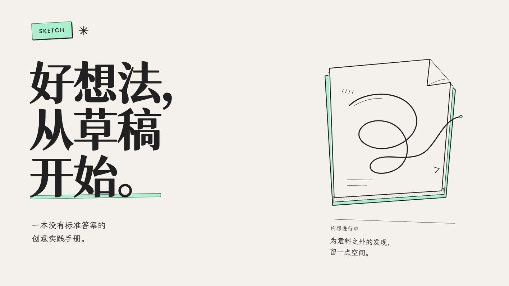</a> <a href="https://raw.githubusercontent.com/ZhouXing-AI/zhouxing-ppt-skill/main/assets/styles/sketch/previews-zh/slide-02.png"></a> <a href="https://raw.githubusercontent.com/ZhouXing-AI/zhouxing-ppt-skill/main/assets/styles/sketch/previews-zh/slide-04.png">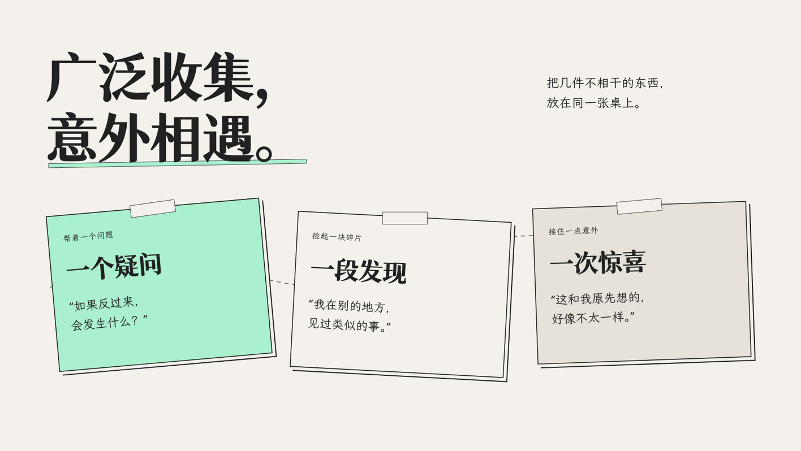</a>

<a href="https://raw.githubusercontent.com/ZhouXing-AI/zhouxing-ppt-skill/main/assets/styles/sketch/previews-zh/slide-05.png">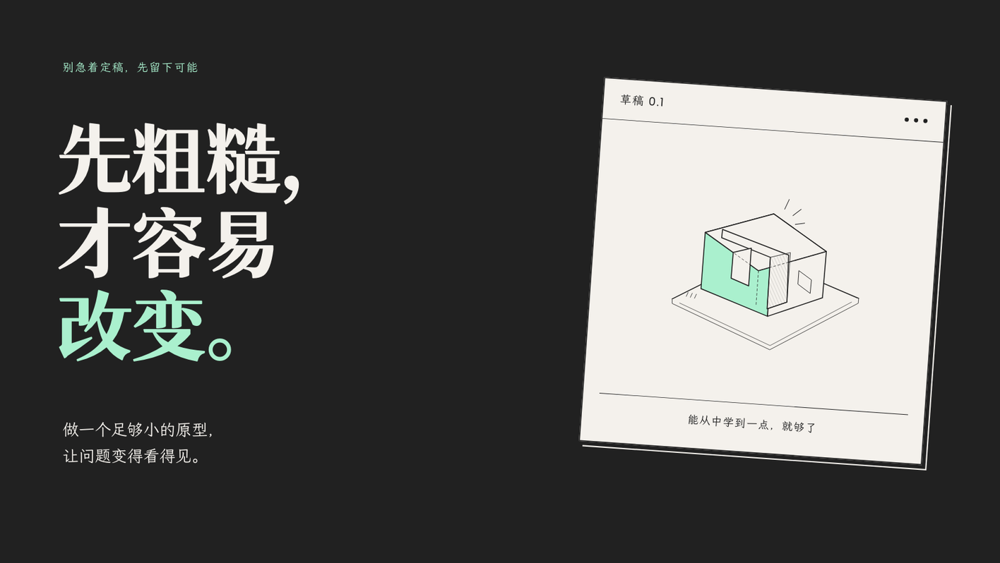</a> <a href="https://raw.githubusercontent.com/ZhouXing-AI/zhouxing-ppt-skill/main/assets/styles/sketch/gallery-zh/slide-11.webp"></a> <a href="https://raw.githubusercontent.com/ZhouXing-AI/zhouxing-ppt-skill/main/assets/styles/sketch/gallery-zh/slide-18.webp"></a>

### [07 · AXIS · 轴线](assets/styles/axis/)

<a href="https://raw.githubusercontent.com/ZhouXing-AI/zhouxing-ppt-skill/main/assets/styles/axis/gallery-zh/slide-01.webp">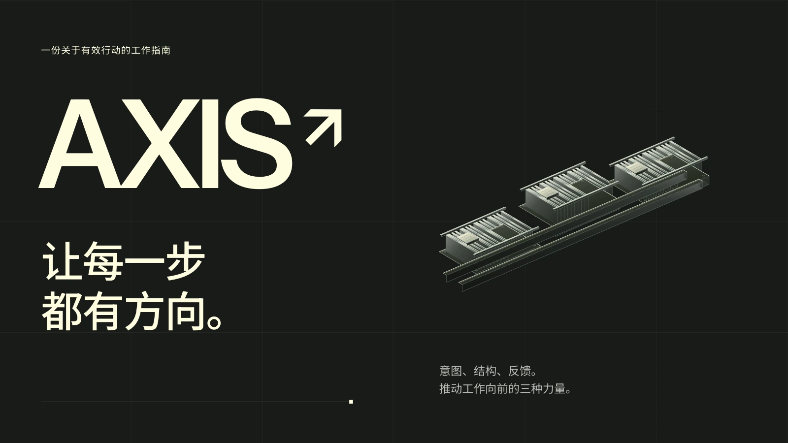</a> <a href="https://raw.githubusercontent.com/ZhouXing-AI/zhouxing-ppt-skill/main/assets/styles/axis/gallery-zh/slide-02.webp">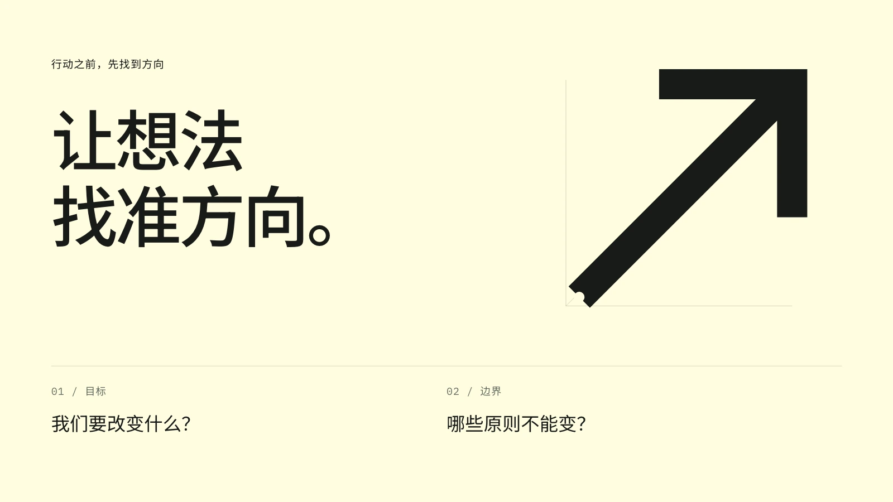</a> <a href="https://raw.githubusercontent.com/ZhouXing-AI/zhouxing-ppt-skill/main/assets/styles/axis/gallery-zh/slide-03.webp"></a>

<a href="https://raw.githubusercontent.com/ZhouXing-AI/zhouxing-ppt-skill/main/assets/styles/axis/gallery-zh/slide-04.webp">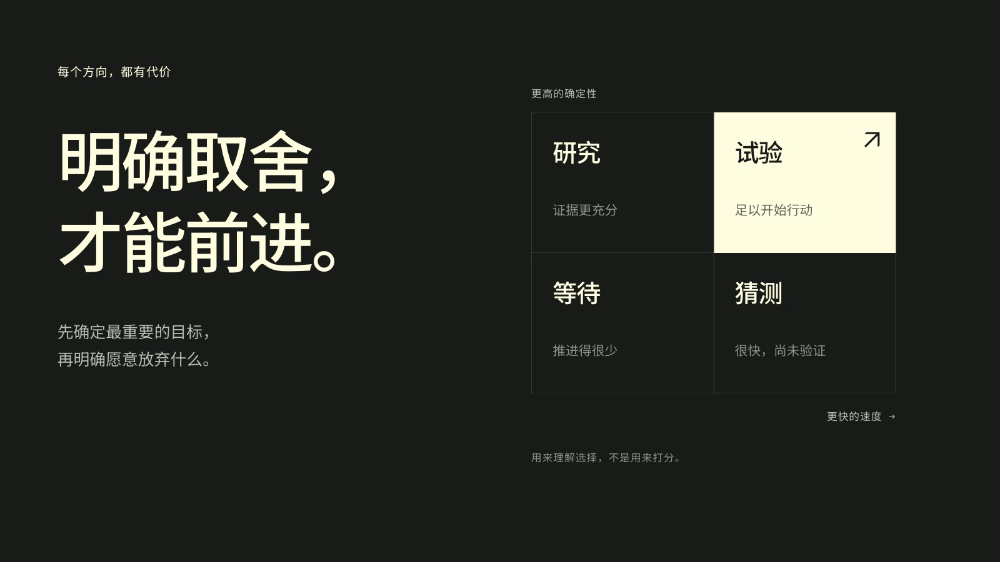</a> <a href="https://raw.githubusercontent.com/ZhouXing-AI/zhouxing-ppt-skill/main/assets/styles/axis/gallery-zh/slide-19.webp">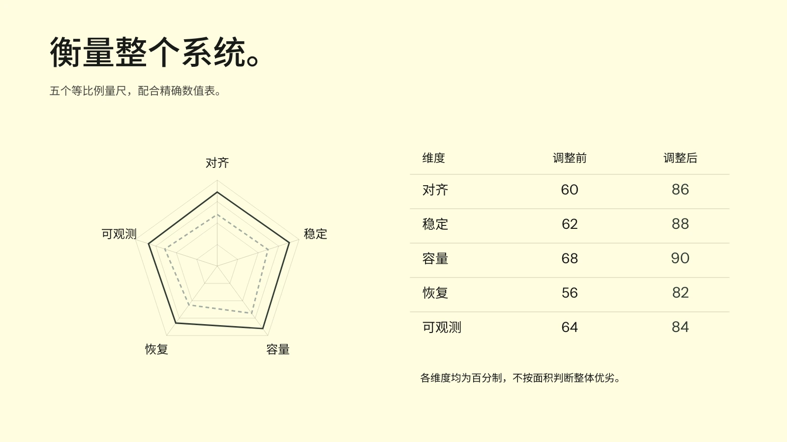</a> <a href="https://raw.githubusercontent.com/ZhouXing-AI/zhouxing-ppt-skill/main/assets/styles/axis/gallery-zh/slide-30.webp"></a>

### [08 · INDEX · 索引](assets/styles/index/)

<a href="https://raw.githubusercontent.com/ZhouXing-AI/zhouxing-ppt-skill/main/assets/styles/index/gallery-zh/slide-01.webp"></a> <a href="https://raw.githubusercontent.com/ZhouXing-AI/zhouxing-ppt-skill/main/assets/styles/index/gallery-zh/slide-02.webp">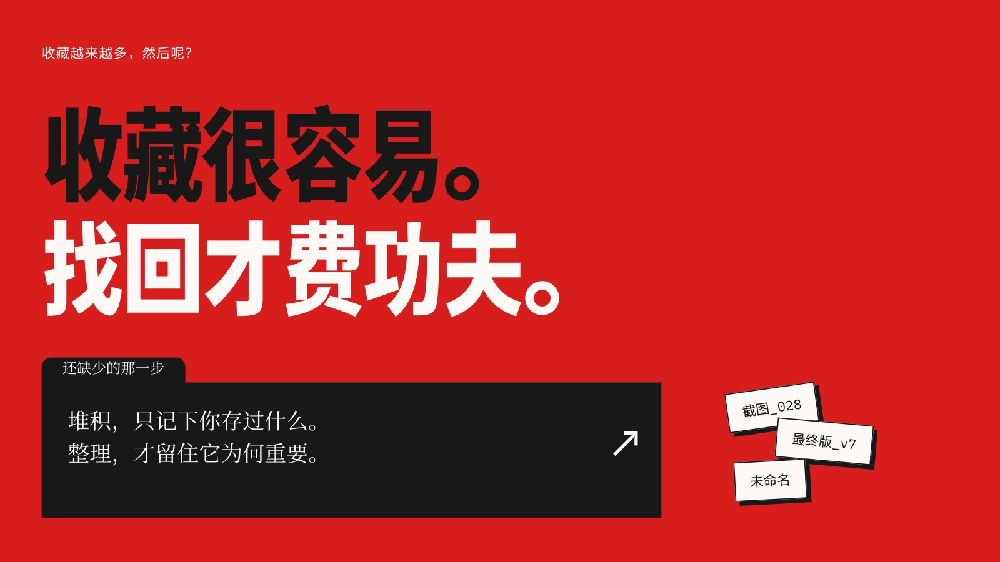</a> <a href="https://raw.githubusercontent.com/ZhouXing-AI/zhouxing-ppt-skill/main/assets/styles/index/gallery-zh/slide-03.webp">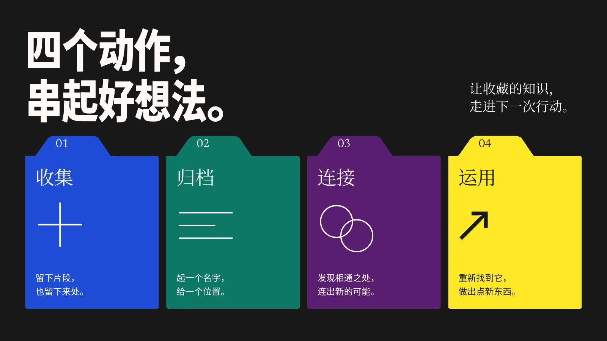</a>

<a href="https://raw.githubusercontent.com/ZhouXing-AI/zhouxing-ppt-skill/main/assets/styles/index/gallery-zh/slide-13.webp"></a> <a href="https://raw.githubusercontent.com/ZhouXing-AI/zhouxing-ppt-skill/main/assets/styles/index/gallery-zh/slide-16.webp"></a> <a href="https://raw.githubusercontent.com/ZhouXing-AI/zhouxing-ppt-skill/main/assets/styles/index/gallery-zh/slide-23.webp">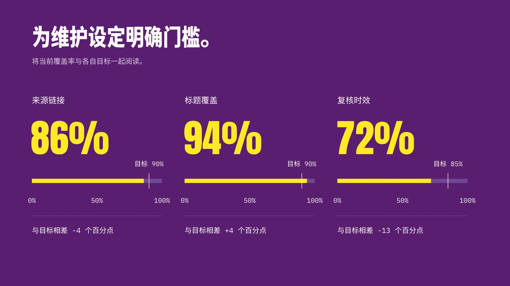</a>

### [09 · FORM · 成形](assets/styles/form/)

<a href="https://raw.githubusercontent.com/ZhouXing-AI/zhouxing-ppt-skill/main/assets/styles/form/gallery-zh/slide-01.webp"></a> <a href="https://raw.githubusercontent.com/ZhouXing-AI/zhouxing-ppt-skill/main/assets/styles/form/gallery-zh/slide-02.webp"></a> <a href="https://raw.githubusercontent.com/ZhouXing-AI/zhouxing-ppt-skill/main/assets/styles/form/gallery-zh/slide-07.webp">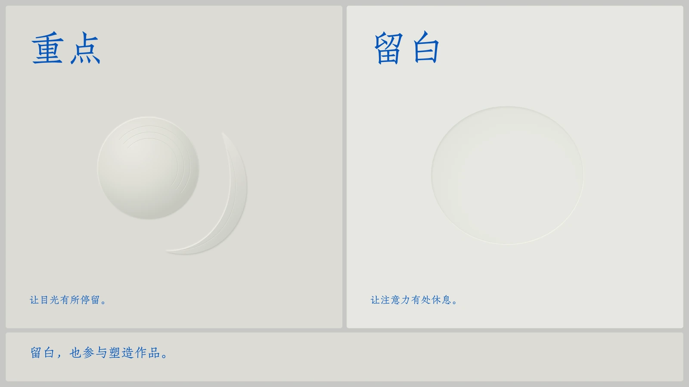</a>

<a href="https://raw.githubusercontent.com/ZhouXing-AI/zhouxing-ppt-skill/main/assets/styles/form/gallery-zh/slide-12.webp">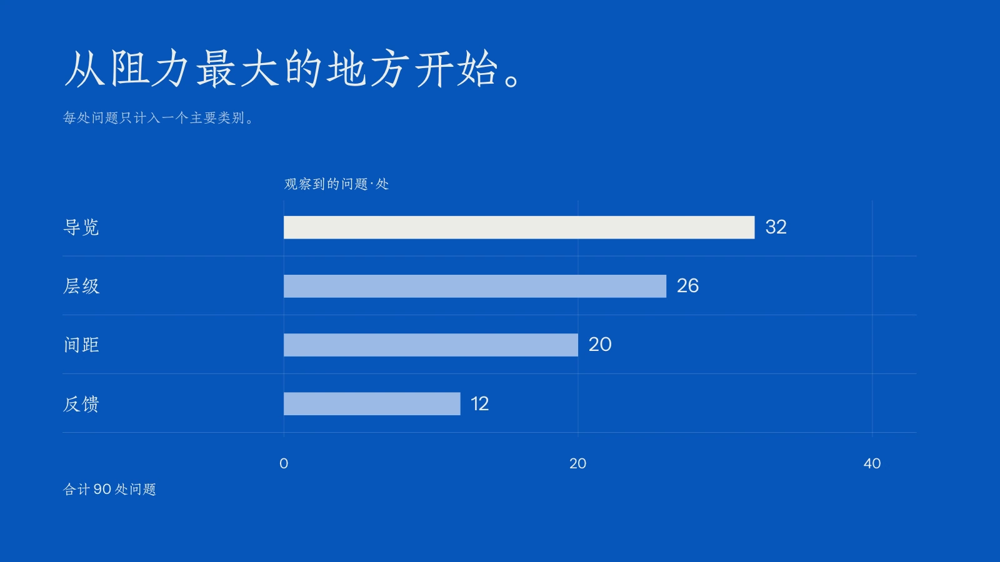</a> <a href="https://raw.githubusercontent.com/ZhouXing-AI/zhouxing-ppt-skill/main/assets/styles/form/gallery-zh/slide-13.webp"></a> <a href="https://raw.githubusercontent.com/ZhouXing-AI/zhouxing-ppt-skill/main/assets/styles/form/gallery-zh/slide-18.webp">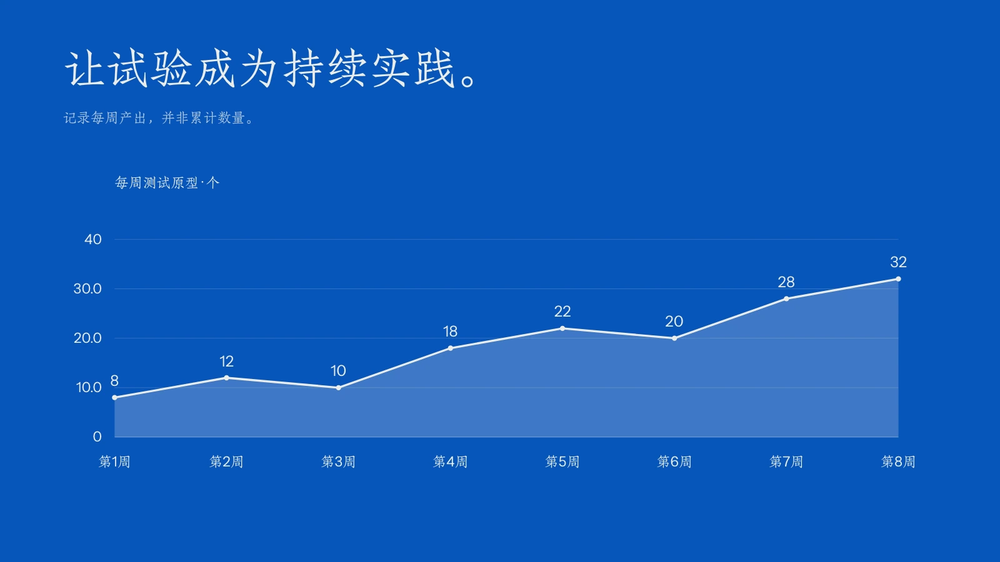</a>

### [10 · LENS · 透见](assets/styles/lens/)

<a href="https://raw.githubusercontent.com/ZhouXing-AI/zhouxing-ppt-skill/main/assets/styles/lens/previews-zh/slide-15.png"></a> <a href="https://raw.githubusercontent.com/ZhouXing-AI/zhouxing-ppt-skill/main/assets/styles/lens/previews-zh/slide-14.png"></a> <a href="https://raw.githubusercontent.com/ZhouXing-AI/zhouxing-ppt-skill/main/assets/styles/lens/previews-zh/slide-16.png"></a>

<a href="https://raw.githubusercontent.com/ZhouXing-AI/zhouxing-ppt-skill/main/assets/styles/lens/previews-zh/slide-10.png"></a> <a href="https://raw.githubusercontent.com/ZhouXing-AI/zhouxing-ppt-skill/main/assets/styles/lens/previews-zh/slide-17.png"></a> <a href="https://raw.githubusercontent.com/ZhouXing-AI/zhouxing-ppt-skill/main/assets/styles/lens/previews-zh/slide-28.png">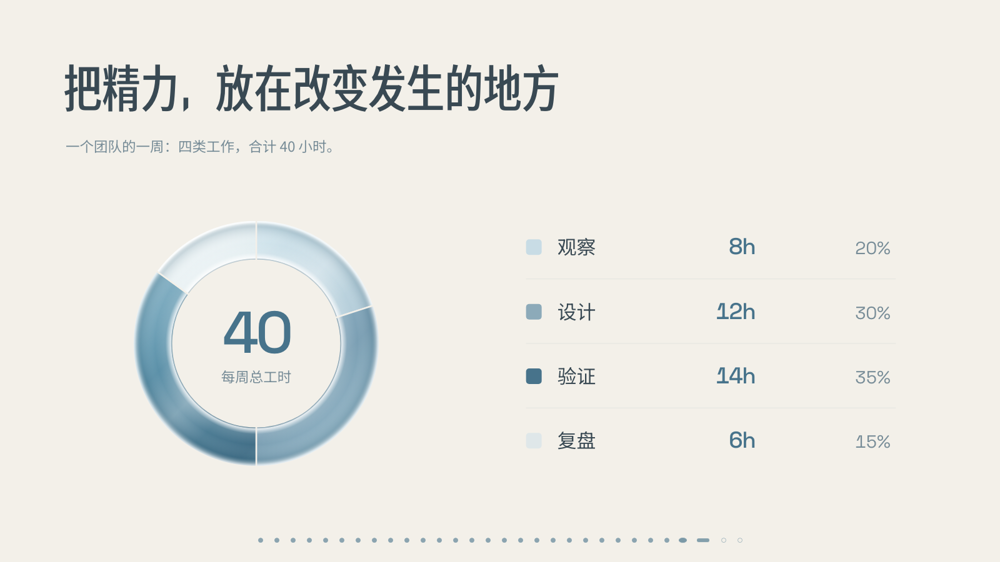</a>

### [11 · FOCUS · 明晰](assets/styles/focus/)

<a href="https://raw.githubusercontent.com/ZhouXing-AI/zhouxing-ppt-skill/main/assets/styles/focus/previews-zh/slide-01.png"></a> <a href="https://raw.githubusercontent.com/ZhouXing-AI/zhouxing-ppt-skill/main/assets/styles/focus/previews-zh/slide-07.png"></a> <a href="https://raw.githubusercontent.com/ZhouXing-AI/zhouxing-ppt-skill/main/assets/styles/focus/previews-zh/slide-10.png">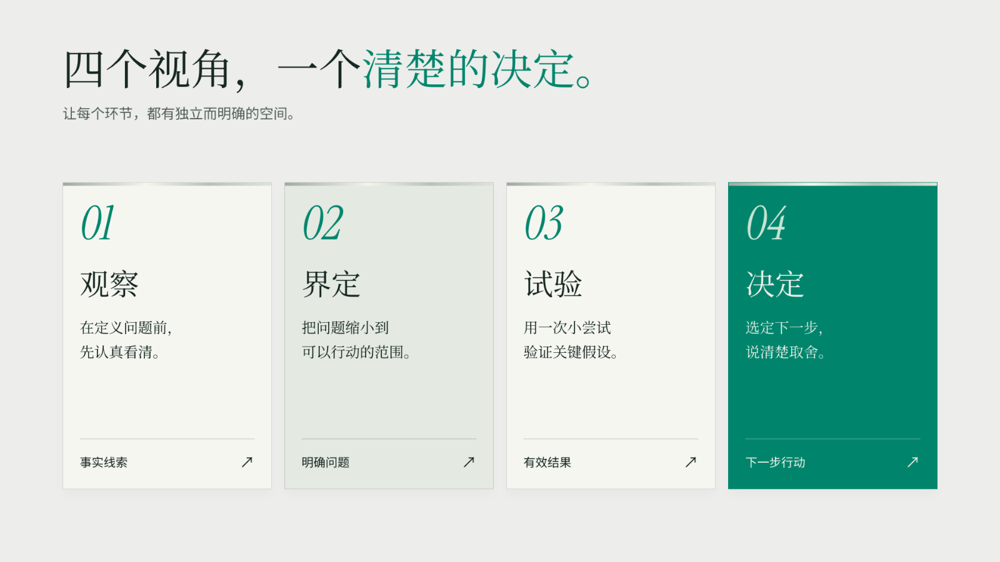</a>

<a href="https://raw.githubusercontent.com/ZhouXing-AI/zhouxing-ppt-skill/main/assets/styles/focus/previews-zh/slide-11.png"></a> <a href="https://raw.githubusercontent.com/ZhouXing-AI/zhouxing-ppt-skill/main/assets/styles/focus/previews-zh/slide-23.png">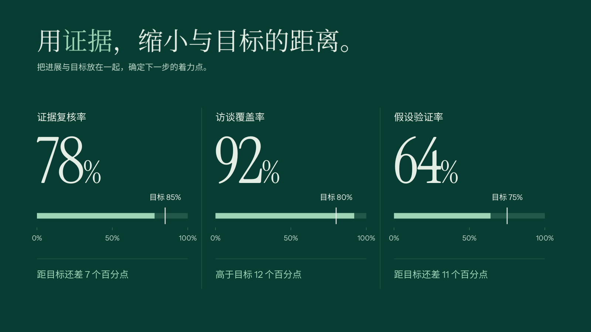</a> <a href="https://raw.githubusercontent.com/ZhouXing-AI/zhouxing-ppt-skill/main/assets/styles/focus/gallery-zh/slide-30.webp">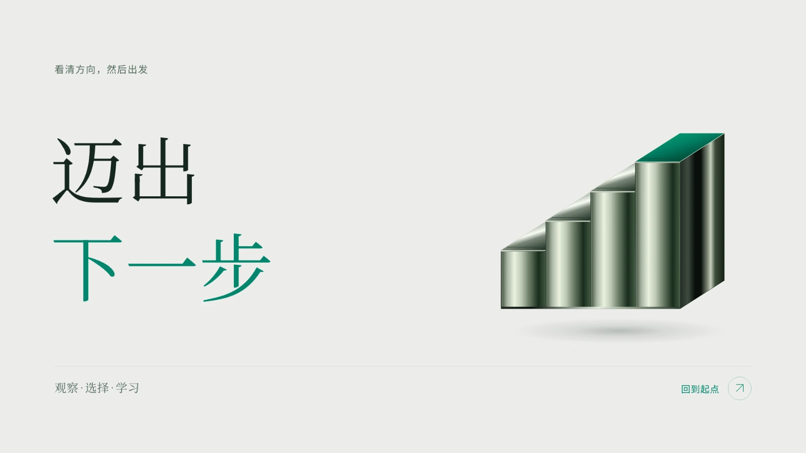</a>

### [12 · EDIT · 精选](assets/styles/edit/)

<a href="https://raw.githubusercontent.com/ZhouXing-AI/zhouxing-ppt-skill/main/assets/styles/edit/previews-zh/slide-03.png">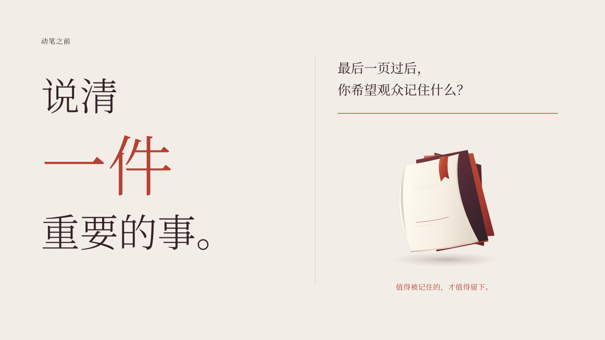</a> <a href="https://raw.githubusercontent.com/ZhouXing-AI/zhouxing-ppt-skill/main/assets/styles/edit/previews-zh/slide-02.png">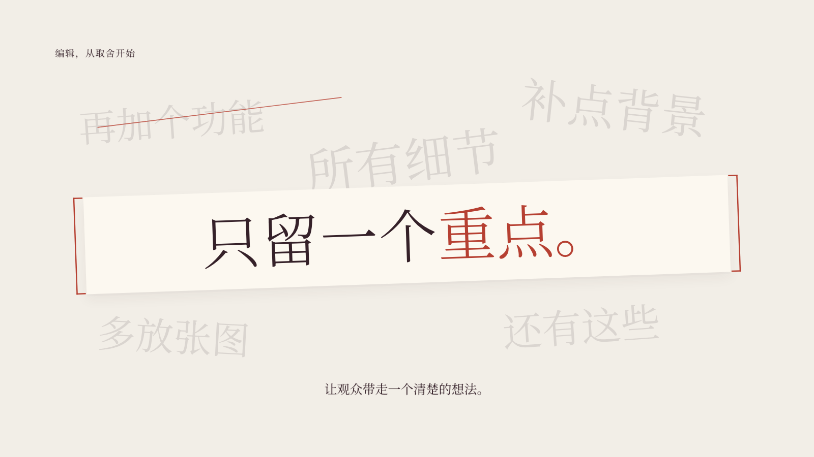</a> <a href="https://raw.githubusercontent.com/ZhouXing-AI/zhouxing-ppt-skill/main/assets/styles/edit/previews-zh/slide-08.png">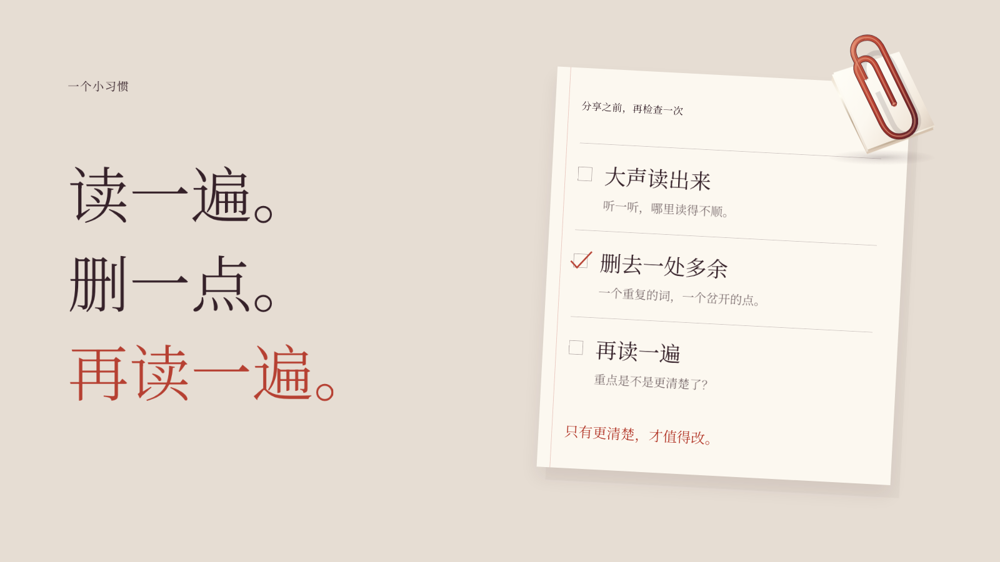</a>

<a href="https://raw.githubusercontent.com/ZhouXing-AI/zhouxing-ppt-skill/main/assets/styles/edit/previews-zh/slide-10.png"></a> <a href="https://raw.githubusercontent.com/ZhouXing-AI/zhouxing-ppt-skill/main/assets/styles/edit/previews-zh/slide-12.png">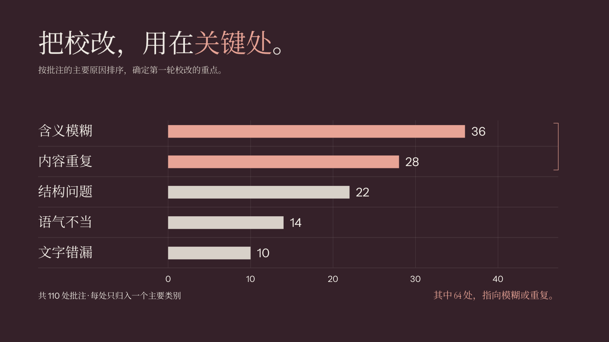</a> <a href="https://raw.githubusercontent.com/ZhouXing-AI/zhouxing-ppt-skill/main/assets/styles/edit/gallery-zh/slide-30.webp"></a>

## 许可

本项目原创代码与文档采用 [MIT 许可证](LICENSE)，版权所有 © 2026 昼星AI说。复制或分发项目代码及其重要部分时，请保留版权和许可声明。

作者：**昼星AI说** · [个人网站](https://zhouxingai.com)  
欢迎在分享或介绍项目时附上项目名称和 GitHub 链接。

各主题字体、SVG 与依赖库的许可文件保留在对应 `assets/styles/<id>/` 目录（含 `fonts/`、`graphics/`、`source/` 下的 LICENSE）。请按各文件条款使用与再分发。
